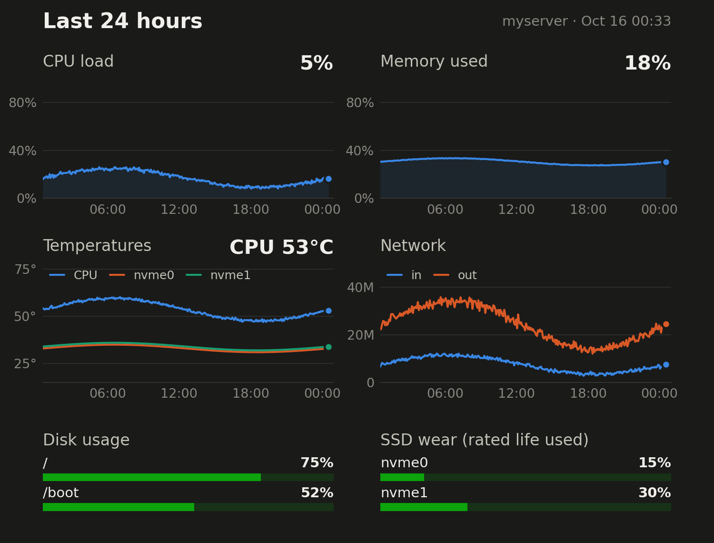

# healthbot

A live server-health dashboard that lives in **one Discord message**.

Every minute, healthbot checks your Linux server and edits the same webhook
message in place: headline stat tiles, a short health summary, and a 24-hour
graph image. When something changes state (a RAID array degrades, a service
dies, a disk fills up), it posts a separate alert that pings you, and a
"Recovered" message when it's fixed.

No bot account, no database, no daemon: one Python file run by a systemd timer.



The message above the graphs looks like this:

```
myserver · server health
🟢  All systems healthy
Updated 1 minute ago

CPU load          Memory              Uptime
5%                11.4 / 63 GiB       2d 13h
load 0.62 · 53°C  18% used            since Oct 13

RAID              Disk /              Containers
md2 ✓ md3 ✓       75%                 9 running
all in sync       115 GiB free        of 20 total

✅ Services — all 3 running
✅ Drives — healthy · wear 15% / 30%
```

## What it watches

| Area | Checks |
|---|---|
| **Storage** | Linux software RAID (`/proc/mdstat`): degraded, rebuilding, inactive (a routine scrub is shown but does not alert) · SMART health of every drive: failure, NVMe wear/spare/media errors, SATA reallocated/pending sectors, temperature · disk usage per mount |
| **System** | CPU load, memory, CPU temperature (AMD, Intel, Raspberry Pi), uptime, network throughput |
| **Services** | systemd units you list must be active · any failed unit · Docker container count |
| **Pterodactyl** *(optional)* | panel schedules that are overdue or stuck, e.g. the scheduler silently stalling after a crash |

Everything is auto-detected where possible: drives via `smartctl --scan`, the
network interface from the default route, md arrays from `/proc/mdstat`.
Drives in standby are not woken up.

### Alerts and dead-man's switch

- The dashboard edit doesn't notify anyone, so state changes post a **new
  message** with a configurable ping (`@here`, a role, a user, or nothing).
- The embed shows `Updated <relative time>`, which keeps ticking in Discord.
  If it says "15 minutes ago", the server or healthbot is down.
- A server can't report its own death. For a ping when it goes completely
  silent, set `healthchecks_url` to a free [healthchecks.io](https://healthchecks.io)
  check (period 1 minute) and connect its Discord integration. When a
  dashboard edit or alert can't reach Discord, healthbot pings the check's
  `/fail` endpoint instead, so you hear about it right away. An alert that
  could not be posted is retried on the next run.

## Install

Requirements: Linux with systemd, Python 3.11+, `matplotlib`, `smartmontools`,
`lm-sensors`. The installer adds the missing packages on Debian and Ubuntu.

```sh
git clone https://github.com/lbzepoqo/healthbot.git
cd healthbot
sudo ./install.sh
```

Then:

1. Create a webhook: Discord channel → *Edit Channel* → *Integrations* →
   *Webhooks* → *New Webhook* → *Copy Webhook URL*.
2. Put it in `/etc/healthbot/config.toml` as `webhook_url`, and list the
   services you care about under `[checks]`. Every option is documented in
   [`config.example.toml`](config.example.toml).
3. Preview without posting anything:
   ```sh
   sudo healthbot --dry-run          # prints the message, writes ./health.png (or --out PATH)
   sudo healthbot --dry-run --demo   # same, with sample data in the graphs
   ```
4. Start it:
   ```sh
   sudo systemctl enable --now healthbot.timer
   ```

The first run posts the dashboard message. After that it is edited in place.
If you delete it, a new one is posted on the next run. The graphs fill in
over the first 24 hours.

To upgrade, `git pull && sudo ./install.sh`. Your config is kept.

## Notes

- healthbot runs as root because SMART data, and the Pterodactyl database
  over its unix socket, need it. It makes outbound HTTPS requests to Discord
  (and your healthchecks URL) only.
- Keep the webhook URL private. Anyone who has it can post to your channel.
  If it leaks, delete the webhook in Discord and create a new one.
- Runs take about 1–2 seconds, mostly drawing the graphs. History is kept in
  `/var/lib/healthbot/history.json` (24 hours of one-minute samples).
- Discord stacks the stat tiles into one column on mobile. That's normal.

## Uninstall

```sh
sudo systemctl disable --now healthbot.timer
sudo rm /usr/local/bin/healthbot /etc/systemd/system/healthbot.{service,timer}
sudo rm -r /etc/healthbot /var/lib/healthbot
```

## License

[MIT](LICENSE)
